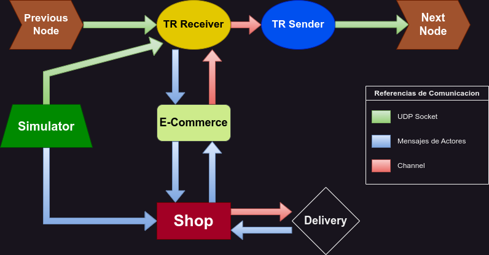

# Trabajo Practico - Tecnicas de Programacion Concurrentes - 2C 2023 - Los Petrifica2++

Informe explicativo sobre la solucion general del TP  

# Introduccion
Para resolver el problema planteado, donde multiples tiendas deben organizarse para resolver pedidos de un servicio de e-commerce, decidimos utilizar un algoritmo descentralizado. Es decir que cada tienda tendra corriendo independientemente de las demas una instancia del programa. Estas instancias del programa tienen el mismo nivel, no hay ningun coordinador por lo que son peers. Ahora bien, como hacen los peers para ponerse de acuerdo quien se hace cargo de un pedido?. Esto lo solucionamos implementando una estructura de token ring, donde todos los peers estan conectados en forma de anillo, y realizan votaciones para determinar quien se debe hacer cargo del pedido. Cada nodo recibira el pedido y anotara, si es que tiene stock para suplirlo, su distancia hasta entregar el pedido. Una vez todo el ring indico su distancia, quien originalmente habia enviado el pedido al ring, manda un mensaje para que el ganador se responzabilice por el pedido.

# Entidades creadas
Las entidades creadas fueron modeladas con actores (por ejemplo, el `Shop` y el `E-Commerce`), mientras que otras  fueron creadas con threads tradicionales (por ejemplo, el `Delivery`, el `TokenRingSender` y `TokenRingReceiver`).

# Shop
El Shop es el actor principal del sistema, es el encargado de manejar el stock de los productos, y de recibir los pedidos. Se puede pensar como una sucursal de una cadena de tiendas, y cada Shop tiene un stock propio de productos. Esta implementado de la siguiente forma: 
```rs
pub struct Shop{
    stock: HashMap<u32, (u32, u32)>,
    location: Point,
    ecomerce_addr: Option<Addr<Ecommerce>>,
    delivery_sender: Sender<Request>
}
```
Donde:
* `stock`: Es un HashMap que tiene como clave el id del producto, y como valor una tupla que contiene la cantidad de stock disponible y la cantidad de stock reservada (es el stock que se esta mandando al cliente cuando este lo pidio por el e-commerce). Cabe destacar que cada stock es propio de cada Shop, y que no hay un stock global de productos (por eso tampoco es necesario hacerlo un recurso compartido y que este detras de un lock para que varios threads/actores puedan acceder a el de forma segura).
* `location`: Es la ubicacion del Shop, y esta representada por un `Point` (un struct que tiene dos campos, `x` e `y`, que representan la ubicacion en un plano cartesiano). Esto lo hacemos para poder calcular la distancia entre un Shop y el destino de un pedido, y asi poder determinar cual es el Shop mas cercano al destino para realizar el envio.
* `ecommerce_addr`: Es el Address del actor del E-Commerce, y se usa para poder comunicarse con el E-Commerce para, por ejemplo, notificarle sobre la falta de stock para un pedido.
* `delivery_sender`: Es el Sender end de un `mpsc::channel`, y se usa para poder comunicarse con el Delivery del Shop. El receptor de este canal es el Delivery, y el sender es el Shop. Se usa para mandarle al Delivery los pedidos que deben ser enviados.

La creacion del stock de un Shop se realiza al inicio del programa, dado por un archivo llamado `shop_stock_n.txt`, que tiene el siguiente formato:
```
coordenada_x coordenada_y
nombre_producto_1,id_producto_1,cantidad_stock_disponible_1,
nombre_producto_2,id_producto_2,cantidad_stock_disponible_2,
...
nombre_producto_n,id_producto_n,cantidad_stock_disponible_n,
```
De esta manera, el stock de un Shop se crea a partir de un archivo, y cada Shop tiene su propio archivo de stock, asi como tambien su propia ubicacion.

# E-Commerce
El E-Commerce es el actor que se encarga de recibir los pedidos realizados por la plataforma online. Existe una instacia de E-Commerce por cada Shop, y se encarga de recibir los pedidos, y comunicarse con el Shop correspondiente para verificar que haya stock suficiente. Esta implementado de la siguiente forma:
```rs
pub struct Ecommerce{
    shop_addr: Addr<Shop>,
    ongoing_coordinate_requests: HashMap<usize, CoordinateRequest>,
    next_id: usize,
    message_sender: Sender<RingMessage>,
}
```
Donde:
* `shop_addr`: Es el Address del Shop correspondiente al E-Commerce.
* `ongoing_coordinate_requests`: Es un HashMap que tiene como clave un `usize` que representa el id del pedido, y como valor un `CoordinateRequest` (explicado mas adelante).
* `next_id`: Es un `usize` que representa el id del proximo pedido a ser realizado. Se usa para poder identificar univocamente cada pedido.
* `message_sender`: Es el Sender end de un `mpsc::channel`, y se usa para poder comunicarse con el `TokenRingSender` (explicado mas adelante).
---
Ambas entidades fueron modeladas como actores, porque su Runtime es manejado por la libreria `actix` y no hay que tener una logica de manejo de threads, ademas de que es una buena forma de modelar entidades que tienen un comportamiento concurrente y se deben comunicar entre si. 

# Simulador de pedidos
El simulador de pedidos es el encargado de generar los pedidos que se realizan en el Shop, a partir de un archivo que contiene el tiempo de arribo del pedido como . 

La logica de los pedidos se realiza con la lectura de un archivo con el siguiente formato:
```
tiempo_sleep_1
id_producto_1,cantidad_producto_1;id_producto_2,cantidad_producto_2;...;id_producto_n,cantidad_producto_n
tiempo_sleep_2
id_producto_1,cantidad_producto_1;id_producto_2,cantidad_producto_2;...;id_producto_n,cantidad_producto_m
...
tiempo_sleep_i
id_producto_1,cantidad_producto_1;id_producto_2,cantidad_producto_2;...;id_producto_n,cantidad_producto_j
```

Cada pedido tiene un tiempo de espera asociado (para que se permita tambien la entrada de pedidos desde el E-Commerce), y que cada pedido tiene un formato de `id_producto,cantidad_producto`. Esto se debe a que un cliente puede pedir mas de un producto a la vez, y por eso se usa el `;` como separador de productos.

El simulador corre sobre un thread aparte, y el simulador se inicia escribiendo `simulate` en la consola cuando el programa esta corriendo. El archivo de pedidos se selecciona segun el Shop que se quiera simular (primer argumento para `cargo run`). Cuando se inicia se encarga de leer el archivo de pedidos y realizar el timeout correspondiente, escuchando sobre un canal cuya unica finalidad es notificar al simulador si se quiere terminar el programa prematuramente. Cumplido este timeout, se lee la linea correspondiente al pedido, y se manda el pedido al shop si es fisico o al ecommerce si es online. Luego se repite el proceso hasta que se termine de leer el archivo de pedidos.

## Pedidos presenciales
Los pedidos presenciales son aquellos que se realizan en la sucursal presencial del Shop, y se tratan de la siguiente manera:
1. Primero, se verifica que haya stock suficiente para el pedido. Si no hay stock suficiente, se le notifica al cliente que no se puede realizar el pedido.
2. Si hay stock suficiente, directamente se resta el stock de la tienda porque el cliente se lleva el producto en el momento.

## Pedidos por E-Commerce
Los pedidos realizados por la plataforma del E-Commerce se tratan casi identicamente a aquellos que son realizados presencialmente en el Shop correspondiente. La diferencia es que, para los pedidos realizados por la plataforma online, se debe tener en cuenta el _envio_ del producto hacia el destinatario, y la reserva de stock correspondiente.  
Un requisito del trabajo era que el pedido debia ser entregado a destino por la sucursal mas cercana a la locacion de la solicitud, y si bien esto podia tener un manejo muy simple (modelar de forma aleatoria), optamos por una implementacion mas realista:  
Recordando que un Shop tiene un atributo que es su `location` como un `Point`, y un pedido online debe tener una "direccion" a donde ser enviado (implementado tambien con un `Point`), lo que hacemos es tomar la distancia entre el destino y cada shop para ver cual esta mas cerca para realizar el envio.  
De esta manera en vez de quedar aleatoriamente determinado, aseguramos de que el tiempo de envio sea optimo.  
  
## Envio de pedidos realizados via E-Commerce
Quedando abatido lo anterior, queda por verse el envio en si del producto. Para esta parte, podemos pensar que cada Shop tiene asociado un sistema de _envio de pedidos_ (algo analogo a como , por ejemplo, un restaurante contrata a PedidosYa para realizar el delivery de comida), y cada vez que el Shop quiere mandar un pedido, se lo delega al sistema de Delivery, llamado `Delivery`   

### Implementacion del struct Delivery
Este struct tiene los siguientes campos:
```rs
struct Delivery{
    shop_addr: Addr<Shop>,
    receiver: Receiver<Request>,
    ongoing_deliveries: BinaryHeap<DeliveryOrder>,
    shop_location:  Point,
    starting_instant: Instant
}
```
* `shop_addr`: Contiene el Address correspondiente al Actor del Shop
* `receiver`: El receiver end de un `mpsc::channel`, usado para recibir los pedidos a ser enviados, y para esperar a que llegue un pedido a destino. El sender end de este canal es el `Shop` que delega el pedido al `Delivery`.
* `ongoing_deliveries`: Es un Heap Minimal, contiene los tiempos de llegada relativos de cada pedido. Decidimos usar esta estructura de datos para poder tener en todo momento el tiempo minimo de llegada de un pedido, y asi poder dormir el thread del Delivery hasta que llegue el proximo pedido.
* `shop_location`: La ubicacion del Shop, usada para calcular la distancia entre el Shop y el destino del pedido.
* `starting_instant`: Representa el instante de tiempo donde empieza la entrega de un pedido. Cada vez que llega un nuevo pedido o finaliza la entrega de uno, se actualiza este campo con el instante de tiempo actual.  WIP
  
### Implementacion del struct DeliveryOrder
El `DeliveryOrder` es un struct creado con la finalidad de poder ordenar los pedidos que deben ser enviados por el Delivery en el Heap. Tiene los siguientes campos:
```rs
struct DeliveryOrder{
    time_to_arrive: u64,
    request: Request
}
```
* `time_to_arrive`: El tiempo que le toma al Delivery llegar al destino del pedido. Se calcula como la distancia entre el Shop y el destino, multiplicado por la velocidad del Delivery (definido como una constante) y se le suma el campo `starting_instant` del Delivery.
* `request`: El pedido a ser enviado.

## Funcionamiento del Delivery
Una vez que el Shop haya procurado tener el stock suficiente para el pedido, se lo delega a su Delivery asociado mandando la orden por medio del channel `sender` del Shop. A partir de aca se realizan las siguientes acciones:
1. Primero, se hace la correspondiente reserva del stock del producto en el Shop, como para un determinado id de un producto tenemos dos campos (que nos indican la cantidad de stock disponible y la cantidad reservada), restamos del stock disponible y sumamos a la cantidad reservada la cantidad de productos pedidos.
2. Luego el Shop informa al delivery que debe enviar un pedido, mandando un mensaje por el channel `sender` del Delivery. Este mensaje es un `Request`, que contiene: 
    * El id del producto pedido
    * La cantidad de productos pedidos
    * La ubicacion del destino del pedido
3. El Delivery recibe el mensaje, origina con el un `DeliveryOrder` y lo inserta en el Heap de pedidos pendientes. Los pedidos se ordenan en el heap por el tiempo de llegada a destino, de menor a mayor, teniendo en cuenta tambien el instante de tiempo en el que se encuentra el `Delivery`, que lo podemos pensar como la hora del dia: si el pedido se realiza a las 10 de la mañana, y el tiempo de llegada es de 2 horas, el pedido llegara a las 12 del mediodia. Si el pedido se realiza a las 11 de la mañana, el pedido llegara a las 13 horas.
4. Una vez que el pedido esta en el Heap, el `Delivery` se duerme (modelado como una escucha con timeout desde el receptor `receiver` del channel). Aca pueden pasar dos escenarios:
    * Si el pedido que esta primero en el heap (el que se esta esperando que llegue) ya llego, se lo saca del heap y, dependiendo si llego a tiempo o no (si el pedido fue cancelado), se actualiza el stock del Shop acordemente. Luego se procede a esperar a la llegada del proximo producto para repetir el procedimiento, o a quedarse escuchando del channel si no hay mas pedidos pendientes.
    * Si el pedido que esta primero en el heap todavia no llego, y se le manda al Delivery otro producto a ser enviado, se lo inserta en el heap, y se actualiza el tiempo de espera del Delivery. Esto se cumple y funciona tanto si llega un producto con un tiempo de espera menor o mayor al que teniamos inicialmente, en ambos casos se actualiza el tiempo de espera del Delivery. 

Esta implementacion contempla que el Delivery puede tener mas de un pedido pendiente, y que los mismos se van a ir entregando en el orden que corresponda.  
Cabe destacar que el envio de los pedidos con esta implementacion se simula **paralelamente** gracias al paso del tiempo. Por ejemplo:  
* Si son las 10 de la mañana, y se pide un producto que tarda 2 horas en llegar, el pedido llegara a las 12 del mediodia.
* Si a las 10:30 se pide otro producto que tarda 1 hora en llegar, el pedido llegara a las 11:30.
* Mientras tanto, el pedido que se realizo a las 10 de la mañana sigue en camino, y llegara a las 12 del mediodia.   
  
Con esto, el Delivery de un Shop en particular puede ser pensado como un sistema de envio de pedidos que tiene una cantidad infinita de repartidores, y que cada repartidor manda 1 solo pedido a la vez.

# Token Ring: Implementacion y mensajes
Como ya se dijo anteriormente usamos una estructura de ring para coordinar que tienda se hace cargo de que pedido. Cuando a un nodo le llega un pedido, este inicia una votacion y la envia al ring. En cada nodo, si es que tiene stock, incluye su distancia hasta el destino. El nodo que inicio la votacion luego manda otro mensaje indicando quien fue el ganador.  
  
Ademas de estos dos mensajes se pueden transmitir los mensajes de conexion y desconexion. Si se recibe un mensaje de desconexion el nodo sacara de su topologia al nodo desconectado. Para conectarse a un token ring ya en ejecucion, lo que se hace es mandar un mensaje `NodeConnection` a cualquiera de los peers, este mensajes da vueltas por la topologia hasta que lo recibe el peer con mayor id. Una vez lo recibe, le envia el `NodeConnection` al nuevo nodo, indicandole cual sera su id y como es la topologia hasta el momento, insertandolo asi justo despues de el.  
  
Este sistema permite la conexion de multiples nuevos nodos en simultaneo.  
Para que el resto de los nodos se enteren de que se agrego un nuevo nodo, este envia un `ConfirmConnection`, que indica su presencia en el ring.

---

Para asegurar que los mensajes lleguen a destino tenemos 2 mecanismos de seguridad. 
Por un lado tenemos un sistema de **ACK**, donde si el nodo 1 le envia un mensaje al nodo 2 este le debera responder con un ack acorde al id del mensaje (formado por el id del nodo que creo el mensaje y un numero de secuencia). Si no se llegara a recibir un ack de un mensaje enviado en un periodo de tiempo determinado saltara un timeout, y si supera una cantidad de timeouts se asume que el siguiente nodo esta desconectado, tomando como proximo nodo al siguiente del desconectado y se envia un 
`NodeDisconnection` asi como tambien todos los mensajes que estaban en espera.  
  

Por otro surge una problematica de que pasa si un nodo se desconecta mientras tenia un mensaje que debia mandar. Para resolver esto, cuando un nodo crea un mensaje, lo almacena para verificar que no se haya perdido, y definimos que cada nodo tiene que reenviar todos los mensajes que reciban, independientemente si los siguientes nodos ya no tienen uso para el. Si despues de un tiempo no llega el mensaje propio del nodo, entonces lo reenvia nuevamente a la red ya que asume que se perdio.
Ahora esta solucion trae 2 nuevo problemas. Que pasa si el nodo que crea el mensaje se muere, entonces quedara un mensaje dando vueltas infinitamente. Para solucionar este caso se usa un sistema de firmas donde cada uno de los nodos que va reenviando el mensaje lo va firmando para indicar que ya lo recibio. Una vez que un nodo reciba un mensaje ya firmado por si mismo no se reenvia. El segundo problema surge cuando se reenvia el mensaje pero este no se habia en realidad perdido, solamente tardo mucho, el nodo entonces recibira dos veces el mensajes. Para solucionar esto, solo procesamos el primer mensaje que nos llega y el repetido se descarta.
  
Cada nodo dentro del ring se compone de dos partes, asi como la posibilidad de conectarlo y desconectarlo del token ring.


## TokenRingReceiver
El `TokenRingReceiver` es el thread que se encarga de recibir los mensajes que circulan a traves del Token Ring. Se comunica con el `TokenRingSender` a traves de un `mpsc::channel` enviandole mensajes del tipo `RingMessages`, y recibe mensajes entrantes de otros nodos de la topologia o del E-Commerce a traves de un socket UDP. 
  
Comparte ciertas cosas con el `TokenRingSender`, como por ejemplo la topologia de peers correspondiente a ese nodo, los `Addresses` de los nodos de la topologia, y los mensajes creados por ese nodo.  
  
Cuando inicia, el `TokenRingReceiver` se queda escuchando a traves del socket para mensajes entrantes (o el fin del programa). Luego de recibido un mensaje, lo maneja acordemente y le manda el resultado al `TokenRingSender` a traves del channel (incluyendo si un mensaje todavia no dio toda la vuelta al Token Ring).

## TokenRingSender
El `TokenRingSender` es el thread que se encarga de enviar y realizar acciones sobre los mensajes que circulan a traves del Token Ring.  
  
El envio de mensajes por parte del Sender a traves del Token Ring se realiza siguiendo el metodo `stop-and-wait`. Para esto, implementamos una ventana de mensajes llamada `Window`: Los mensajes que manda el `TokenRingSender` son puestos en esta ventana a la espera de ser recibidos, de esta forma podemos tener varios mensajes circulando a traves del Token Ring al mismo tiempo, mandados por el mismo nodo.
  
A su vez, como la comunicacion se hace a través de un socket UDP, no tenemos la garantia de que el mensaje llegue a destino, por lo que implementamos un mecanismo de reenvio de mensajes. Este mecanismo se basa en un timeout, y si el mensaje no llega a destino en un tiempo determinado, se lo vuelve a mandar. Para chequear si el mensaje llego a destino, uno de los mensajes que se mandan es un ACK, y si el nodo que manda el mensaje no recibe el ACK en el timeout, se lo vuelve a mandar. 
  
Si un mensaje timeoutea muchas veces, se considera que el nodo al que se le esta mandando el mensaje se desconecto del Token Ring, y se lo saca de la topologia del Token Ring. Esto se hace para evitar que se queden nodos desconectados del Token Ring, y que se queden esperando mensajes que nunca van a llegar, y tambien causando un corte en la comunicacion con los otros nodos.

Si un mensaje se quiere mandar cuando la ventana esta llena, se lo guarda en una cola de mensajes, y cuando se libera un lugar en la ventana, se manda el mensaje que esta en la cola. De todas formas existe un metodo del `TokenRingSender` que permite mandar un mensaje sin importar si la ventana esta llena o no para casos especificos.
  
El `TokenRingSender` recibe los mensajes sobre el receiver end del channel que lo comunica con el `TokenRingReceiver`, leyendo con un timeout especifico (el menor entre todos los mensajes que fueron mandados). Dependiendo de si el mensaje dio toda la vuelta al Token Ring o no, se lo manda a la ventana para que sea enviado o se encola a la espera de que se libere un lugar en la ventana.

# Relacion entre los componentes
  
  
En el thread principal, se inician todas las entidades correspondientes para un Shop (actores y su nodo del Token Ring), y luego se queda esperando por terminal a que el usuario ejecute los comandos correspondientes. Luego de que se quiera terminar la ejecucion, se terminan los threads corespondientes al `TokenRingReceiver` y al `TokenRingSender`, se termina el delivery, la simulacion y se matan a los actores del Shop y del E-Commerce.

# Instrucciones de ejecucion:
Para realizar la ejecucion del programa se debe pasar un parametro `n` que debe ser un numero natural. Este valor se utiliza para la simplificacion de las direcciones de los sockets de distintos programas.  
Todos los nodos del token ring son corridos sobre las direcciones IP `"127.0.0.1"` con el puerto `10000 + n`, mientras que los simuladores utilizan las direccion Ip `"127.0.0.2"` y el puerto `20000 + n`. Si se corre `cargo run n`, se iniciara un nuevo Shop en una topologia vacia. Si se quiere agregar un nodo a una topologia ya existente se debe indicar la direccion del nodo al que se quiere conectar, por ejemplo `cargo run 1 127.0.0.1:10000`.
Una vez corriendo el programa se pueden ejecutar algunos comandos:
* **exit**: Termina la ejecucion del nodo
* **simulate**: Inicia una simulacion si ya no hay una corriendo donde se toma el archivo `./simulation_files/simulation_n.txt` para simular
* **topology**: Muestra por terminal el estado actual de la topologia
* **disconnect**: Desconecta al nodo de la topologia
* **connect**: Si no se le pasa parametros connecta al nodo en un nuevo ring. Si se le pasa una direccion de otro nodo de un ring ya establecido, intentara conectarse a el.